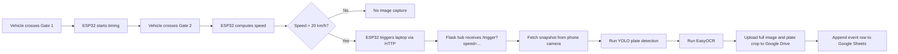

# Speed Number Plate Detection

Vehicle speed detection and automatic number plate capture system built with:

- An ESP32-based two-gate IR speed sensor
- A Python Flask hub running on a laptop
- A phone camera serving snapshot images over Wi-Fi
- YOLO + EasyOCR for license plate detection and reading
- Google Drive + Google Sheets for storage and logging

## Overview

This project measures the speed of a passing vehicle using two IR beam gates placed a fixed distance apart. When the measured speed crosses the configured speed limit, the ESP32 sends an HTTP request to a laptop. The laptop then:

1. Captures a snapshot from a phone IP camera
2. Detects the number plate using a YOLO model
3. Reads the plate text using EasyOCR
4. Uploads the full image and plate crop to Google Drive
5. Logs the event into Google Sheets

The current implementation uses:

- Gate distance: `2.0 m`
- Speed limit: `20 km/h`
- Max valid speed filter: `80 km/h`

## System Architecture



## Repository Layout

```text
Speed_NumberPlate_Detection/
+-- IR-2Gate-TxRx-LCD-ImgCapture/
|   +-- IR-2Gate-TxRx-LCD-ImgCapture.ino
+-- SpeedCamHub/
    +-- hub.py
    +-- lpr.py
    +-- credentials.json
    +-- token.json
    +-- captures/
    +-- models/
        +-- best.pt
```

## Main Components

### 1. ESP32 firmware

File: `IR-2Gate-TxRx-LCD-ImgCapture/IR-2Gate-TxRx-LCD-ImgCapture.ino`

Responsibilities:

- Generates modulated IR transmit bursts at `38 kHz`
- Alternates Gate 1 and Gate 2 transmitters to reduce cross-talk
- Reads the two IR receiver signals using interrupts
- Measures the time between the first and second beam break
- Calculates vehicle speed
- Triggers the laptop only when overspeed is detected

Key logic:

- Beam present threshold: `60 ms`
- Beam break confirmation: `25 ms`
- System arm stability: `300 ms`
- Gate 2 timeout: `2.0 s`
- Gate 2 dead time: `80 ms`
- ESP32 trigger cooldown: `1500 ms`

### 2. Python hub service

File: `SpeedCamHub/hub.py`

Responsibilities:

- Exposes `GET /trigger?speed=<value>`
- Downloads one image from the configured phone snapshot URL
- Saves the image locally in `captures/`
- Runs number plate detection and OCR
- Uploads images to Google Drive
- Logs event data to Google Sheets

### 3. License plate reader

File: `SpeedCamHub/lpr.py`

Responsibilities:

- Loads the YOLO detector from `models/best.pt`
- Detects the best plate bounding box
- Crops and preprocesses the region
- Uses EasyOCR to read alphanumeric plate text
- Returns:
  - plate text
  - detection confidence
  - OCR confidence
  - cropped plate image

## Hardware Required

- ESP32 development board
- 2 x IR transmitters
- 2 x IR receiver modules
- Current-limiting resistors for IR LEDs
- Stable power supply for the ESP32 and sensors
- Phone running an IP camera app or equivalent snapshot server
- Laptop running Python and connected to the same Wi-Fi network

The code also includes LCD support, but the core speed and capture logic depends on the two IR gates, Wi-Fi, and the Python hub.

## Wiring

### Core connections

From the firmware pin mapping:

- `GPIO25` -> Gate 1 IR transmitter drive
- `GPIO26` -> Gate 2 IR transmitter drive
- `GPIO32` <- Gate 1 receiver output
- `GPIO33` <- Gate 2 receiver output
- `GND` -> common ground for all sensor modules

### Recommended practical wiring

```text
ESP32 GPIO25 -> resistor -> Gate1 IR LED anode
Gate1 IR LED cathode -> GND

ESP32 GPIO26 -> resistor -> Gate2 IR LED anode
Gate2 IR LED cathode -> GND

Gate1 receiver OUT -> GPIO32
Gate1 receiver VCC -> 3.3V
Gate1 receiver GND -> GND

Gate2 receiver OUT -> GPIO33
Gate2 receiver VCC -> 3.3V
Gate2 receiver GND -> GND
```

Notes:

- Use a common ground between the ESP32 and both receiver modules.
- For longer range and stronger IR output, a transistor driver for each transmitter is better than driving LEDs directly from the GPIO pins.
- The firmware expects modulated IR operation at `38 kHz`, so demodulating IR receiver modules are the right match.

## How The Speed Measurement Works

The firmware runs as a simple state machine:

### 1. Wait for both beams to be healthy

The system does not arm until both gates are aligned and stable.

### 2. Wait for Gate 1 break

When the first beam is interrupted and remains broken long enough to pass the debounce/confirmation threshold, the ESP32 stores the start timestamp.

### 3. Wait for Gate 2 break

When the second beam is interrupted, the ESP32 calculates:

```text
speed_kmh = (gate_distance_m / delta_time_s) * 3.6
```

With the current configuration:

```text
speed_kmh = (2.0 / delta_time_s) * 3.6
```

### 4. Overspeed action

If the computed speed is above `20 km/h`, the ESP32 sends:

```text
http://<laptop-ip>:5000/trigger?speed=<speed>
```

If the speed is below the limit, the event is ignored for image capture.

## How The Image Capture And Logging Works

When the Flask service receives `/trigger`:

1. It checks a software cooldown (`2.0 s`)
2. It reads the `speed` query parameter
3. It downloads a JPEG snapshot from the phone camera URL
4. It saves the file in `SpeedCamHub/captures/`
5. It runs the LPR pipeline
6. It optionally writes a cropped number plate image
7. It uploads the full image and crop to Google Drive
8. It appends an event row to Google Sheets

The Google Sheets row contains:

- timestamp
- measured speed
- overspeed flag
- Drive link to the full image
- recognized plate text
- detection confidence
- OCR confidence
- Drive link to the cropped plate image

## Configuration

### ESP32 firmware settings

Edit these values in `IR-2Gate-TxRx-LCD-ImgCapture.ino`:

- `WIFI_SSID`
- `WIFI_PASS`
- `LAPTOP_IP`
- `LAPTOP_PORT`
- `GATE_DISTANCE_M`
- `SPEED_LIMIT_KMH`
- `MAX_VALID_SPEED_KMH`

### Python hub settings

Edit these values in `SpeedCamHub/hub.py`:

- `PHONE_SNAPSHOT_URL`
- `DRIVE_FOLDER_ID`
- `SPREADSHEET_ID`
- `SHEET_TAB_NAME`
- `COOLDOWN_SECONDS`
- `MODEL_PATH`

## Software Requirements

### Python

Recommended: Python `3.10+`

Packages used by the current code:

```bash
pip install flask requests opencv-python numpy google-auth google-auth-oauthlib google-api-python-client easyocr ultralytics torch torchvision torchaudio
```

Depending on your environment, the PyTorch installation may need to follow the official install instructions for your CPU or GPU setup.

### Arduino / ESP32

Install support for:

- ESP32 board package
- `WiFi.h`
- `HTTPClient.h`
- `Wire.h`
- `LiquidCrystal_I2C.h`

## Google Drive And Google Sheets Setup

The Python hub uses OAuth credentials.

Expected files in `SpeedCamHub/`:

- `credentials.json`
- `token.json`

On first run:

- `credentials.json` is used to authorize access
- `token.json` is created or refreshed automatically

Required API scopes:

- Google Sheets read/write
- Google Drive file access

Also prepare:

- a target Google Drive folder
- a target Google Spreadsheet

Then place the corresponding IDs into `hub.py`.

## YOLO Model

The number plate detector is loaded from:

```text
SpeedCamHub/models/best.pt
```

The project assumes this file is already trained and available. The repo does not include model training code.

## Running The Project

### 1. Flash the ESP32

Open:

```text
IR-2Gate-TxRx-LCD-ImgCapture/IR-2Gate-TxRx-LCD-ImgCapture.ino
```

Update Wi-Fi and network settings, then upload the sketch to the ESP32.

### 2. Start the Python hub

From the project root:

```bash
cd SpeedCamHub
python hub.py
```

The server listens on:

```text
http://0.0.0.0:5000
```

### 3. Start the phone IP camera

Run an IP camera app or other service that exposes a snapshot endpoint matching:

```text
http://<phone-ip>:8080/shot.jpg
```

### 4. Align the IR gates

Position Gate 1 and Gate 2 exactly `2.0 m` apart, aligned so both beams are detected cleanly before a vehicle enters the measurement zone.

### 5. Test the trigger path

You can test the Flask hub manually:

```bash
curl "http://127.0.0.1:5000/trigger?speed=35.5"
```

If the phone snapshot URL, model, and Google credentials are valid, the hub should:

- save a capture
- detect and read the plate
- upload images
- append a row to Sheets

## Typical Runtime Flow

1. Both IR gates are stable
2. Vehicle breaks Gate 1
3. ESP32 starts timing
4. Vehicle breaks Gate 2
5. ESP32 calculates speed
6. If overspeed, ESP32 calls the laptop
7. Laptop fetches image from phone
8. Laptop runs plate detection + OCR
9. Laptop uploads results to Drive and logs to Sheets

## Troubleshooting

### No speed measurement

- Verify both IR receivers are powered and aligned
- Check that Gate 1 and Gate 2 are actually `2.0 m` apart
- Watch serial output from the ESP32 for beam state changes

### Speed looks wrong

- Recheck gate spacing
- Confirm the vehicle crosses Gate 1 before Gate 2
- Check for false triggers or beam reflections
- Use more stable transmitter/receiver mounting

### Overspeed detected but no capture happens

- Confirm ESP32 and laptop are on the same Wi-Fi network
- Verify `LAPTOP_IP` and port `5000`
- Verify the Flask server is running

### Flask server returns errors

- Check that `PHONE_SNAPSHOT_URL` is reachable
- Check that `models/best.pt` exists
- Check that Google OAuth credentials are valid
- Check that Drive and Sheets IDs are correct

### Plate text is blank or poor

- Improve camera angle and image sharpness
- Increase plate visibility and lighting
- Retrain or replace the YOLO plate detector
- Consider OCR post-processing for local plate formats

## Security Notes

The current project layout contains hardcoded network identifiers and local credential files. For a cleaner production-ready setup:

- do not commit Wi-Fi credentials
- do not commit OAuth tokens
- move secrets to environment variables or ignored local config files
- add a `.gitignore` for generated captures and tokens

## Current Limitations

- Single-image snapshot capture only
- No video tracking or multi-frame plate confirmation
- Hardcoded IPs and resource IDs
- No dependency manifest file yet
- No automated tests included
- Plate format validation is not implemented

## Future Improvements

- Add `requirements.txt`
- Move configuration to `.env`
- Add a transistor driver reference circuit for IR transmitters
- Save structured logs locally in addition to Sheets
- Add plate format validation and duplicate suppression
- Add unit tests for the Flask hub and OCR pipeline

## License

No license file is currently included in this repository.
